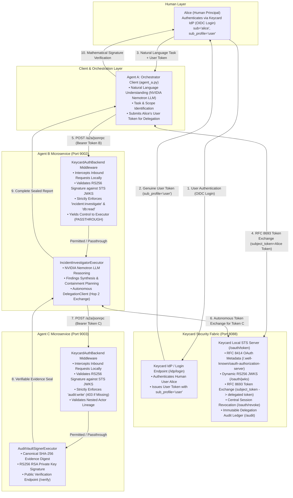
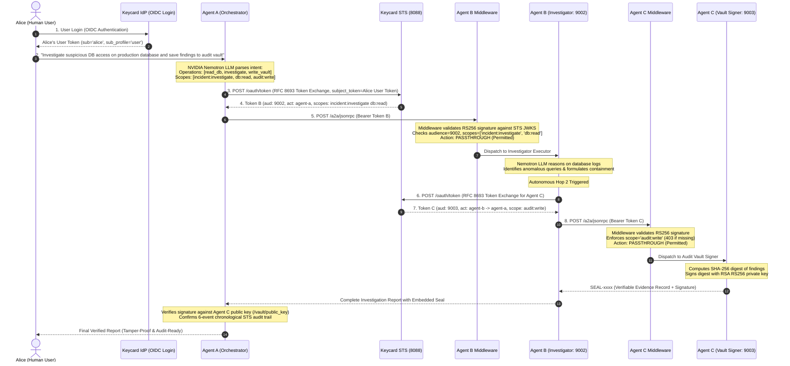

# Keycard Multi-Agent (A2A) Production Architecture & Governance

This repository implements a production-grade **Autonomous Multi-Agent Authorization Architecture** using the official **Keycard A2A SDK** (`keycardai-a2a`, `keycardai-starlette`) and the **Google Agent-to-Agent (A2A) Protocol** (`a2a-sdk`), reusing open-source executors from [`a2aproject/a2a-samples`](https://github.com/a2aproject/a2a-samples).

Rather than relying on static scripts, mock payloads, or shared root API keys, the system demonstrates **autonomous multi-hop delegation**, **human user identity preservation**, **in-process middleware request interception**, **cryptographic evidence sealing**, and **centralized governance with cascading revocation**.

---

## 1. System Architecture & Component Overview



---

## 2. Architectural Clarity: Where Does the Middleware Live?

A critical architectural distinction to maintain:
- **Keycard STS (Port 8088) is OUT-OF-BAND**: It is **not** an in-line API gateway. Agent payload traffic never passes through STS. STS only issues, exchanges, and revokes tokens.
- **Keycard Middleware is EMBEDDED IN EACH AGENT**: `KeycardAuthBackend` sits directly inside Agent B and Agent C's HTTP application pipeline. Every incoming HTTP request is intercepted and policed locally by the receiving agent before hitting any business logic.
- **Middleware Semantics**: In ASGI/Starlette, authentication middleware **never returns an HTTP 200 OK**. It either **rejects** an unauthorized request (`401 Unauthorized` or `403 Forbidden`) or **passes through** (`request.user` populated), allowing the downstream A2A JSON-RPC handler to process the request and return the application response.

```mermaid
flowchart LR
    subgraph Agent_A["Agent A (Caller)"]
        A_Out["HTTP Client"]
    end

    subgraph Agent_B["Agent B (Receiver - Port 9002)"]
        B_MW["KeycardAuthBackend Middleware\n[Runs on EVERY incoming request]"]
        B_App["Agent Logic / LLM Executor"]
        B_MW -->|Valid RS256 & Scopes\n(Yield / Passthrough)| B_App
        B_MW -->|Invalid Signature or Expired| Deny401["401 Unauthorized"]
        B_MW -->|Missing Required Scope| Deny403["403 Forbidden"]
        B_App -->|Execution Successful| Resp200["HTTP 200 OK (A2A JSON-RPC)"]
    end

    subgraph OutOfBand["Out-of-Band Authority"]
        STS["Keycard STS (Port 8088)\n• Public JWKS (/oauth/jwks)\n• Revocation Registry"]
    end

    A_Out -->|"Direct HTTP POST /a2a/jsonrpc (Bearer JWT)"| B_MW
    B_MW -.->|"Resolves Public Key via JWKS"| STS
    B_MW -.->|"Checks Session Revocation"| STS
```

---

## 3. Platform Integration vs. Local Reference Architecture

To maintain rigorous technical precision, this codebase separates **Official Keycard SDK Components** from the **Local Reference Simulator**:

| Component | Layer | Implementation Source | Responsibility |
|---|---|---|---|
| **`KeycardAuthBackend`** | Agent Middleware | Official SDK (`keycardai-starlette`) | Intercepts requests, validates Bearer tokens via public JWKS, builds `KeycardUser` and `KeycardAuthCredentials`, handles RFC 6750 / RFC 9728 challenges. |
| **`DelegationClient`** | Agent Client | Official SDK (`keycardai-a2a`) | Performs RFC 8693 token exchange preserving user context in delegation chain; wraps Google A2A `SendMessage` requests. |
| **`keycard_user`** | Context Helper | Official SDK (`keycardai-a2a`) | Extracts `KeycardUser` (carrying `sub`, `client_id`, `scopes`, and `access_token`) from the A2A execution context. |
| **`requires`** | Route Guard | Official SDK (`keycardai-starlette`) | Declarative decorator enforcing required scopes (`insufficient_scope` 403 challenge). |
| **`keycard_server.py`** | Security Fabric | Local Reference Simulator | Local OAuth 2.0 / RFC 8693 Authorization Server (Port 8088) emulating the contract of Keycard Cloud Zone (`https://<zone_id>.keycard.cloud`). |

### Cedar Policy Representation in Keycard Cloud
In production Keycard Cloud, the authorization rules enforced in this demonstration map directly to **Cedar policies**:

```cedar
// Policy 1: Permit Agent B to investigate incidents and read database logs on behalf of Alice
permit(
    principal in Keycard::Role::"IncidentInvestigator",
    action in [Keycard::Action::"incident:investigate", Keycard::Action::"db:read"],
    resource == Keycard::Resource::"ProductionWorkload"
) when {
    context.sub_profile == "user" && context.root_subject == "alice"
};

// Policy 2: Permit Agent C to cryptographically seal audit records
permit(
    principal == Keycard::Application::"agent-b",
    action == Keycard::Action::"audit:write",
    resource == Keycard::Resource::"AuditVault"
) when {
    context.delegation_chain.contains("agent-a")
};

// Policy 3: Explicitly forbid destructive database actions
forbid(
    principal,
    action == Keycard::Action::"db:delete",
    resource == Keycard::Resource::"ProductionWorkload"
);
```

---

## 4. Human Identity vs. Machine Credentials & Delegation Lineage

### Distinguishing Human Users from Client Applications
- **Machine-to-Machine (`client_credentials`)**: Authenticates an application acting on its own behalf. The token has `sub_profile: "app"` and `sub: "<client_id>"`. There is no human user present.
- **Human User Delegation (`/idp/login` / OIDC)**: Alice authenticates through an Identity Provider. The resulting token has `sub_profile: "user"` and `sub: "alice"`.
- **RFC 8693 Token Exchange**: When Agent A requests a token for Agent B, it supplies Alice's User Token as `subject_token`. Keycard preserves Alice as the root subject while establishing an unforgeable `act` (actor) chain:

```text
Alice (Human Principal)
  └─ Initial User Token: [sub: "alice", sub_profile: "user", client_id: "agent-a"]
      │
      ▼ (Hop 1: Agent A exchanges Alice's User Token for Agent B)
Token B:
  • sub:         "alice"
  • sub_profile: "user"
  • aud:         "http://127.0.0.1:9002"
  • client_id:   "agent-a"
  • act:         {"sub": "agent-a"}
  • scope:       "incident:investigate db:read audit:write"  <-- Attenuated
      │
      ▼ (Hop 2: Agent B autonomously exchanges Token B for Agent C)
Token C:
  • sub:         "alice"
  • sub_profile: "user"
  • aud:         "http://127.0.0.1:9003"
  • client_id:   "agent-b"
  • act:         {"sub": "agent-b", "act": {"sub": "agent-a"}}  <-- Cryptographic Lineage Preserved
  • scope:       "audit:write"                                  <-- Narrowed to least privilege
```

---

## 5. End-to-End Execution Sequence Diagram



---

## 6. Natural-Language Entry Point (`agent_a.py`)

Users interact with the system using **plain-English instructions**. No manual `curl` commands or token handling are required.

### Interactive Mode:
```bash
python agent_a.py
```
```text
======================================================================
       KEYCARD MULTI-AGENT (A2A) AUTONOMOUS WORKFLOW
  Natural Language ➔ Orchestrator ➔ Keycard STS ➔ Multi-Hop Agents
======================================================================

Enter your natural-language task (or press Enter for default):
Default: Investigate suspicious database access on the production database. Analyze the access logs, identify the responsible activity, and save the investigation findings in the audit vault.

Alice > 
```

### Direct Command-Line Execution:
```bash
python agent_a.py "Investigate unauthorized database access on production customers table and seal findings"
```

### Real-Time Terminal Output Layout:
```text
── PLANNING ───────────────────────────────────────────────
[Agent A] Interpreting natural-language user intent...
[Agent A] ✓ Intent interpreted via NVIDIA Nemotron LLM:
  • Summary:         Investigate unauthorized database access on production DB
  • Operations:      ['analyze_access_logs', 'identify_responsible_activity', 'save_findings_to_audit_vault']
  • Target Agents:   ['log_analyzer', 'db_access_monitor', 'audit_vault_writer']
  • Required Scopes: ['incident:investigate', 'db:read', 'audit:write']

── AUTHENTICATION & TOKEN EXCHANGE ────────────────────────
[Keycard IdP] Authenticating human user 'alice' on application client 'agent-a'...
  • User Credential:    AUTHENTICATED via IdP (sub='alice', sub_profile='user')
  • Session ID:         sess_40c1524b4f34
  • User Root Scopes:   support:read tasks:delegate incident:investigate db:read audit:write

[Keycard STS] Performing RFC 8693 Token Exchange for Agent B (http://127.0.0.1:9002)...
  • Subject Token:      Alice's User Token (Delegation Lineage Root)
  • Requesting Actor:   agent-a (Agent A)
  • Exchanged Token B:  ACQUIRED
  • Target Audience:    http://127.0.0.1:9002
  • Attenuated Scopes:  incident:investigate db:read audit:write
  • Delegation Lineage: [alice (User) -> agent-a (Actor) -> http://127.0.0.1:9002]

── AGENT B: INCIDENT INVESTIGATION ────────────────────────
[Agent A] Invoking Agent B via Google A2A JSON-RPC (Bearer Token B)...
[Agent B] ✓ Investigation Completed in 4.42s
  • Category: Unauthorized Database Access
  • Findings: Log analysis identified 47 anomalous queries from external IP 203.0.113.42 between 02:14–02:38 UTC. Queries targeted sensitive tables (users, payments, credentials) using a decommissioned service account.
  • Containment Action: Immediately revoked compromised service account, blocked source IP at perimeter, set database to read-only, and opened high-priority SOC ticket.

── AGENT C: AUDIT VAULT SEAL & VERIFICATION ───────────────
[Agent A] Retrieving Agent C public key and verifying cryptographic signature...

======================================================================
   AGENT C CRYPTOGRAPHIC AUDIT EVIDENCE VERIFIER                      
======================================================================
  • Seal ID:            SEAL-1795510556-43684A
  • Signer:             Agent C (Audit Vault Signer)
  • Algorithm:          RS256 (RSASSA-PKCS1-v1_5 with SHA-256)
  • Evidence Digest:    sha256:dfd83251b9d3e3506121ff650e78188f68f98b24e040b502d5183bfadc8f6e68
  • Delegated Lineage:  [alice -> agent-a -> agent-b -> agent-b -> agent-c]
  • Signature (B64):    S9kI1ZXRcjbOVjCaKhM1cQ1cOkxJxXJ1W86N...
----------------------------------------------------------------------
  ✔ CRYPTOGRAPHIC SIGNATURE VALID
    Evidence digest verified against Agent C RSA public key.
    Lineage accountability and tamper-resistance mathematically proven.
======================================================================

── KEYCARD DELEGATION AUDIT LEDGER ────────────────────────
  1. [USER_AUTHENTICATED_IDP] decision=AUTHORIZED actor=alice target=
  2. [TOKEN_EXCHANGE_SUCCESS] decision=AUTHORIZED actor=agent-a target=http://127.0.0.1:9002
  3. [AGENT_AUTHORIZATION] decision=AUTHORIZED actor=Agent B (Incident Investigator) target=/a2a/jsonrpc
  4. [TOKEN_EXCHANGE_SUCCESS] decision=AUTHORIZED actor=agent-b target=http://127.0.0.1:9003
  5. [AGENT_AUTHORIZATION] decision=AUTHORIZED actor=Agent C (Audit Vault Signer) target=/a2a/jsonrpc
  6. [EVIDENCE_SIGNED] decision=AUTHORIZED actor=Agent C (Audit Vault Signer) target=SEAL-1795510556-43684A

── FINAL RESULT ───────────────────────────────────────────
  • Incident Investigation:  COMPLETED
  • Audit Vault Record:      STORED
  • Cryptographic Seal:      VERIFIED (RS256 Signature Valid)
  • Runtime Authorization:   VERIFIED (Least-Privilege Maintained across 2 Hops)
```

---

## 7. Real-Time Middleware Event Logging

Agent B and Agent C's embedded middleware (`KeycardAuthBackend`) emits structured logs in real time as requests are intercepted:

### Agent B Middleware Log (Read Path):
```text
[14:40:51] [AGENT B MIDDLEWARE] ── INCOMING A2A REQUEST ──
  • Endpoint: /a2a/jsonrpc | Method: POST
  • Token Verification: VALID RS256 JWKS SIGNATURE (Keycard STS Port 8088)
  • Principal Context: sub='alice' (Human User), sub_profile='user'
  • Calling Client Application: client_id='agent-a'
  • Required Scope: 'incident:investigate' | Held Scopes: ['incident:investigate', 'db:read', 'audit:write']
  • Scope Evaluation: GRANTED (Policy Verified)
  • Middleware Action: PASSTHROUGH (Permitted) ➔ Yielding to Investigator Executor (A2A Handler will return response)
```

### Agent C Middleware Log (Write Path):
```text
[14:40:56] [AGENT C MIDDLEWARE] ── INCOMING A2A REQUEST ──
  • Endpoint: /a2a/jsonrpc | Method: POST
  • Token Verification: VALID RS256 JWKS SIGNATURE (Keycard STS Port 8088)
  • Principal Context: sub='alice' (Human User), sub_profile='user'
  • Calling Client Application: client_id='agent-b' (Agent B)
  • Required Scope: 'audit:write' | Held Scopes: ['audit:write']
  • Scope Evaluation: GRANTED (Permission Attenuation Verified)
  • Middleware Action: PASSTHROUGH (Permitted) ➔ Yielding to Audit Vault Signer (A2A Handler will return response)
```

---

## 8. Security Defenses & Attack Testing

The gateway polices both authentication (401) and authorization/scope boundaries (403):

| Test Scenario | Attack Description | Expected Code | Defensive Mechanism |
|---|---|:---:|---|
| **Unauthenticated Request** | Calling Agent B without Authorization header | `401 Unauthorized` | Intercepted by `KeycardAuthBackend` |
| **Tampered Token** | Altering JWT signature bytes | `401 Unauthorized` | Fails RS256 cryptographic signature check |
| **Expired Token** | Presenting token past its TTL | `401 Unauthorized` | Fails timestamp expiration check |
| **Audience Replay** | Replaying Agent B token against Agent C | `401 Unauthorized` | Audience mismatch (`aud != http://127.0.0.1:9003`) |
| **Missing Permission** | Token holds `support:read` but lacks `audit:write` | `403 Forbidden` | Strict scope enforcement |
| **Scope Escalation** | Requesting prohibited scope (`db:delete`) | `403 Forbidden` | Intercepted by Keycard STS delegation policy |
| **Unauthorized Delegator** | Rogue agent attempting token exchange | `403 Forbidden` | Intercepted by registered delegator policy |
| **Session Revocation** | Calling agents after administrator kill switch | `401 Unauthorized` | Central session invalidation |

### Run Automated Security Tests via CLI:

#### 1. Unauthorized Operation Test (`db:delete`):
```bash
python agent_a.py --test-unauthorized
```
```text
── SECURITY TEST: UNAUTHORIZED OPERATION ATTEMPT (HTTP 403) 
[Scenario] Agent A attempts to delegate prohibited scope 'db:delete' to Agent B.
  • Keycard STS Response: HTTP 403 Forbidden
  • Policy Interception:  Scope escalation detected. Scope 'db:delete' is prohibited.
  • ✔ SECURITY VERIFIED: Destructive action was blocked at the gateway.
```

#### 2. Central Kill Switch Revocation Test:
```bash
python agent_a.py --test-revocation
```
```text
── SECURITY TEST: CENTRAL REVOCATION & KILL SWITCH (HTTP 401) 
[Scenario] Alice's session is revoked centrally at Keycard STS. Downstream tokens are rejected.
  • Revocation status: Session 'sess_xxxx' has been revoked immediately across all downstream agents.
  • Agent B Middleware: HTTP 401 Unauthorized
  • ✔ SECURITY VERIFIED: Lineage invalidation propagated to downstream agent.
```

---

## 9. Quickstart & Production Runbook

### Prerequisites
- Python 3.10+
- Virtual environment with dependencies installed:
  ```bash
  cd keycard
  source .venv/bin/activate
  ```

### Configuration (`.env`)
Create or verify [.env](file:///home/berrybytes/Office/Assignment/keycard/.env) (template in [.env.example](file:///home/berrybytes/Office/Assignment/keycard/.env.example)):
```bash
NVIDIA_API_KEY="your-nvidia-api-key"
NVIDIA_MODEL="nvidia/nemotron-3.5-lightning-30b-a3b"
STS_URL="http://127.0.0.1:8088"
AGENT_B_URL="http://127.0.0.1:9002"
AGENT_C_URL="http://127.0.0.1:9003"
```

### 1. Start Services
Launch all three microservices in the background:
```bash
./start_servers.sh
```
Check health:
```bash
curl -s http://127.0.0.1:8088/health | jq .
curl -s http://127.0.0.1:9002/health | jq .
curl -s http://127.0.0.1:9003/health | jq .
```

### 2. Run the Workflow (3 Options)

#### Option A: Natural-Language Orchestrator (Recommended)
```bash
python agent_a.py
```
Or with custom input:
```bash
python agent_a.py "Investigate repeated failed authentication attempts on bastion host"
```

#### Option B: Multi-Stage Showcase Runner
```bash
./demo_stages.sh 1 "Custom Incident"   # Run Scenario 1 (Happy Path)
./demo_stages.sh 2                     # Run Scenario 2 (7 Security Attacks)
./demo_stages.sh 3                     # Run Scenario 3 (Kill Switch)
./demo_stages.sh all                   # Run all scenarios
```

#### Option C: Reproduce with Raw `curl` Commands
See [Raw `curl` Reproduction Guide](file:///home/berrybytes/.gemini/antigravity/brain/17def851-2e32-4fc9-bb3f-c894c3764a65/KEYCARD_A2A_ARCHITECTURE_AND_DEMO_GUIDE.md#4-end-to-end-demonstration-playbook) for exact copy-pasteable commands for every step.

---

## 10. File & Component Reference

| File | Role |
|---|---|
| [agent_a.py](file:///home/berrybytes/Office/Assignment/keycard/agent_a.py) | Natural language entry point and workflow orchestrator. |
| [agent_b_server.py](file:///home/berrybytes/Office/Assignment/keycard/agent_b_server.py) | Agent B Incident Investigator (Port 9002), Google A2A server, Nemotron LLM reasoning. |
| [agent_c_server.py](file:///home/berrybytes/Office/Assignment/keycard/agent_c_server.py) | Agent C Audit Vault Signer (Port 9003), RS256 cryptographic evidence signer. |
| [keycard_server.py](file:///home/berrybytes/Office/Assignment/keycard/keycard_server.py) | Keycard Local STS Server (Port 8088), RFC 8414 metadata, JWKS, RFC 8693 exchange. |
| [verify_seal.py](file:///home/berrybytes/Office/Assignment/keycard/verify_seal.py) | Standalone CLI verifier for Agent C RSA digital signatures. |
| [decode_jwt.py](file:///home/berrybytes/Office/Assignment/keycard/decode_jwt.py) | Runtime authorization visibility inspector (`act` claim, scopes, lineage). |
| [start_servers.sh](file:///home/berrybytes/Office/Assignment/keycard/start_servers.sh) | Starts all services in the background and verifies health. |
| [stop_servers.sh](file:///home/berrybytes/Office/Assignment/keycard/stop_servers.sh) | Cleanly terminates all running services. |
| [demo_stages.sh](file:///home/berrybytes/Office/Assignment/keycard/demo_stages.sh) | Interactive terminal showcase runner. |
| [.env](file:///home/berrybytes/Office/Assignment/keycard/.env) | Configuration file for NVIDIA NIM API key and service endpoints. |
